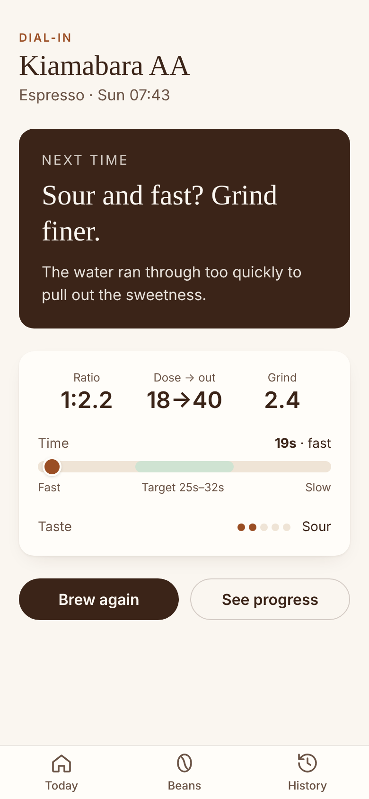

# ☕ Brew Journal

A small, private brew journal for your phone. Log a brew in under 20 seconds, get one plain-English dial-in hint ("Sour and fast? Grind finer."), and watch each bag of beans improve over time.

<p>
  
  
  
  
</p>

## What it does

- **New brew**: espresso, V60, AeroPress or French press. Dose, yield, time and grind are prefilled from your last brew of that bean.
- **Dial-in hint**: ratio, shot time against the method's target, and one nudge based on taste first, then time.
- **Bean shelf**: roaster, roast date, days since roast (Resting / Peak / Past best), open or finished.
- **Bean detail**: taste score over time and your best recipe.
- **History**: every brew by month, with JSON export and import for backups.
- Installable PWA that works offline.

## Run it

```bash
npm install
npm run dev      # http://localhost:5173  (add ?demo=1 to load sample data)
npm test         # vitest
npm run build    # type-check + production build to dist/
```

Built with Vue 3 (Composition API), TypeScript, Vite, Tailwind CSS and vite-plugin-pwa. No server, no database, no account.

## Privacy

Your data stays on your device, in the browser's local storage. Nothing is sent anywhere, and there are no analytics or third-party scripts. Use **History → Export backup** to keep a copy, since clearing browser data will delete your journal.

## Deploying

`.github/workflows/pages.yml` can publish to GitHub Pages. It only runs when triggered by hand, and only after Pages is enabled in the repo settings.
