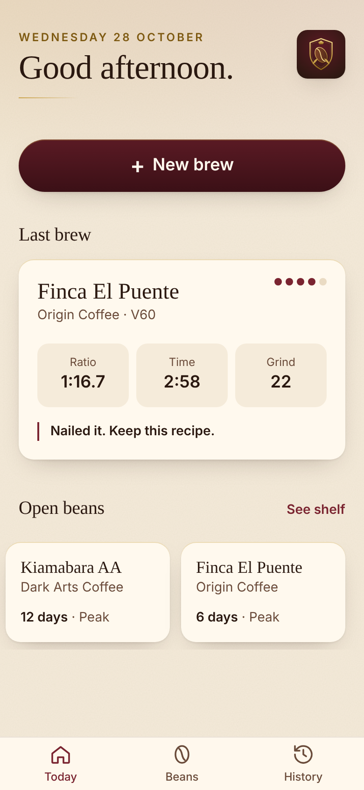
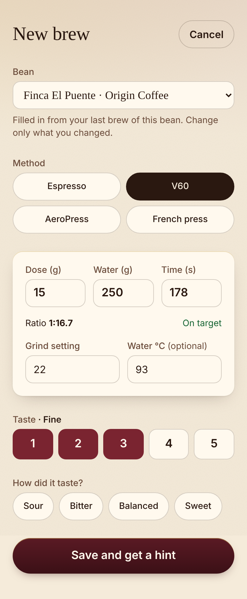
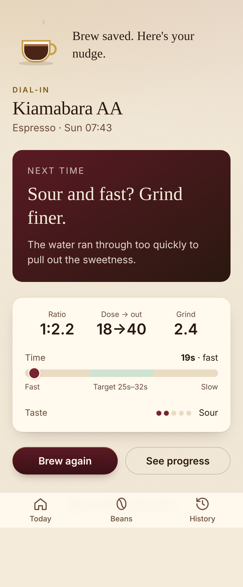
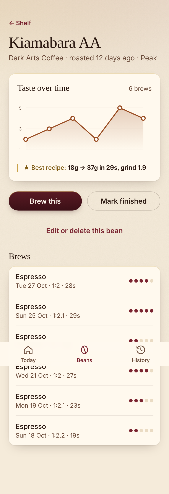

<p align="center"></p>

# Brew Journal

A private coffee journal for your phone. Log a brew in under 20 seconds, get one plain-English dial-in hint, and watch each bag of beans get better.

It's an installable web app (PWA). It works offline, needs no account, and keeps your data on your device.

<p>
  
  
  
  
</p>

## Features

- **New brew**: espresso, V60, AeroPress or French press. It fills in your last recipe for that bean, so you only change what you changed.
- **Dial-in hint**: shows the ratio and your time against the method's target, then gives one nudge. It reads taste first, then time.
- **Bean shelf**: shows each bean's roaster and days since roasting (Resting, Peak or Past best). Mark a bag finished when it's empty.
- **Bean detail**: a chart of taste over time and a ★ best-recipe badge.
- **History**: every brew by month. You can edit or delete any brew or bean.
- **Backups**: export to JSON, and import by merging or replacing.
- Installable, with shortcuts (New brew, Bean shelf). Animations respect "reduce motion".

## Run it

```bash
npm install
npm run dev      # http://localhost:5173  (add ?demo=1 for sample data)
npm test         # vitest
npm run build    # type-check + production build into dist/
```

Built with Vue 3 (Composition API), TypeScript, Vite, Tailwind CSS and vite-plugin-pwa. No server, no database, no third-party scripts or fonts.

## Privacy

Your data stays on your device, in your browser's local storage. There's no tracking. See [public/privacy.html](public/privacy.html).

## Docs

- [User guide](docs/USER_GUIDE.md)
- [Brewing guide](docs/BREWING_GUIDE.md)
- [Deploying to GitHub Pages](docs/DEPLOY.md)
- [Contributing](docs/CONTRIBUTING.md)
- [Changelog](docs/CHANGELOG.md)
